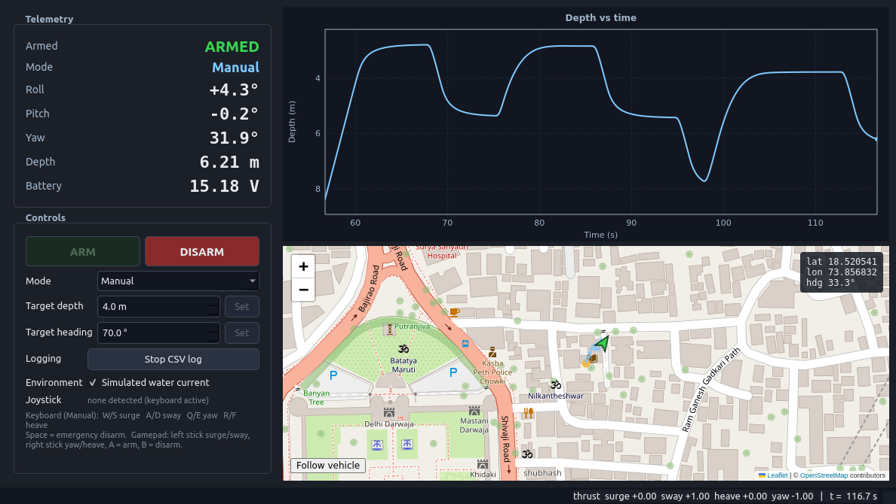

# ROV Telemetry Ground Station

A native desktop application (Python 3.10 + PySide6 / Qt 6) that simulates a small
underwater vehicle and lets an operator monitor and control it.
Built for the Coratia Technologies software-internship technical assessment.



Video walkthrough: [`docs/walkthrough.mp4`](docs/walkthrough.mp4) (77 s, interface only, recorded from the running app).

## Features

| Requirement | Where |
|---|---|
| Movement simulation: forward, sideways, up/down, turning, drag, thruster-response delay | `rov_sim/simulator.py` |
| Live armed state, mode, roll, pitch, yaw, depth, battery voltage | `gui/telemetry_panel.py` |
| Arm / Disarm, Manual / Depth Hold / Heading Hold | `gui/controls_panel.py`, `gui/main_window.py` |
| Keyboard **and** joystick control in Manual | `gui/main_window.py` (keys), `gui/joystick.py` (pygame) |
| Target depth / heading inputs; PID hold controllers | `rov_sim/controllers.py` |
| Safety: zero thrust when disarmed; zero thrust after 1 s without input in Manual | `rov_sim/safety.py` |
| Live depth-vs-time plot | `gui/depth_plot.py` (QPainter, no plotting library) |
| OpenStreetMap view with vehicle marker and trail | `gui/map_view.py` + `gui/map.html` (Leaflet, vendored) |
| Responsive UI during simulation | 50 Hz sim timer, 20 Hz UI timer, 2 Hz map updates |
| Optional extras: CSV logging, simulated water current, unit tests | `logging_util/`, controls panel checkbox, `tests/` |

## Run it

Requires Python 3.9+ on Linux, macOS or Windows. Internet access is only needed
for map tiles (the app works offline; the map shows the track over a blank base).

```bash
git clone https://github.com/singhayush5062-star/rov-telemetry-ground-station.git
cd rov-telemetry-ground-station
python3 -m venv .venv
.venv/bin/pip install -r requirements.txt
.venv/bin/python main.py
```

or simply `./run.sh` (creates the venv on first run). Run the tests with
`.venv/bin/python -m pytest`.

## Controls

| Input | Action |
|---|---|
| **ARM / DISARM** buttons, or gamepad **A / B** | arm / disarm (thrust is forced to zero while disarmed) |
| **Space** | emergency disarm |
| **W / S** | surge forward / back |
| **A / D** | sway left / right |
| **Q / E** | yaw left / right |
| **R / F** | heave up / down |
| Gamepad left stick | surge / sway |
| Gamepad right stick | yaw / heave |
| Mode combo | Manual, Depth Hold, Heading Hold |
| Target depth / heading + **Set** | hold target (defaults to the current value when the mode is entered) |
| **Start CSV log** | writes `logs/rov_<timestamp>.csv` at 10 Hz |
| **Simulated water current** | adds a constant 0.2 m/s north-east drift |

In Depth Hold the controller owns the heave axis and the operator keeps the
others; in Heading Hold the controller owns yaw. Any key press refreshes the
Manual-mode watchdog; one second without input returns thrust to zero.

## Architecture

```
main.py                       entry point (QApplication + MainWindow)
rov_sim/        pure Python, no Qt imports -> unit-testable in isolation
  simulator.py  ROVState, ROVParams, ROVSimulator.step(cmd, dt)
  controllers.py PID, DepthHold, HeadingHold, build_command()
  safety.py     ArmState, Mode, InputWatchdog, apply_safety()
gui/            PySide6 widgets
  main_window.py   layout, timers, keyboard, mode/arm logic (the only place that calls the sim)
  telemetry_panel.py / controls_panel.py
  depth_plot.py    rolling 60 s plot drawn with QPainter
  map_view.py      QWebEngineView wrapper; map.html + vendor/leaflet (Leaflet 1.9.4, BSD-2)
  joystick.py      pygame gamepad polling
logging_util/csv_logger.py
tests/          pytest: safety invariants, dynamics, controller convergence, mapping, logging
```

**One tick (50 Hz, on the GUI thread):**

```
operator input (keys / gamepad)
    -> build_command()   merges the active hold controller's axis
    -> apply_safety()    disarmed => zero; Manual + watchdog expired => zero; clamp to [-1, 1]
    -> simulator.step()  thruster lag, drag, kinematics, battery
```

The simulation step is a few microseconds of arithmetic, so it runs on the GUI
thread from a `QTimer` and needs no locking. Widgets refresh on a separate 20 Hz
timer; the map marker is updated at 2 Hz through `runJavaScript`. A 2-minute
soak test (modes cycling, logging on, current on) measured a mean tick period of
20.03 ms, p99 22.7 ms, with flat memory.

## Simulation model

State: position `x, y` (m, local tangent plane), `depth` (m, +down), `yaw`,
`roll`, `pitch` (deg), body velocities `u, v, w`, yaw rate `r`, battery voltage.

Command: `surge, sway, heave, yaw` each in [-1, 1].

* **Thruster response delay** – first-order lag, time constant 0.25 s:
  `T += (T_cmd - T) * dt / tau`
* **Drag** – linear + quadratic per axis:
  `a = (T * F_max - c_lin * v - c_quad * v * |v|) / m` with m = 11 kg, F_max = 40 N
* **Yaw** – same form with torque and rotational drag.
* **Depth** is clamped at the surface (0 m); heading is wrapped to [0, 360).
* **Roll / pitch** – small damped responses to sway/surge acceleration plus a
  little noise so the readouts move.
* **Battery** – 16.8 V full, slow linear discharge plus sag proportional to
  total thrust demand; floor 12 V.
* **Water current** (optional) – constant velocity added in the world frame.
* **Map position** – flat-earth offset from a fixed launch point (Pune, 18.5204 N 73.8567 E).

## Hold modes

Both holds are discrete PID loops with output clamping and integrator
anti-windup (`rov_sim/controllers.py`).

* **Depth Hold:** error = target − depth → heave command. Gains 0.8 / 0.05 / 0.9.
  Converges to within 15 cm of a 5 m target in under 40 s (tested).
* **Heading Hold:** error = shortest signed angle (target − yaw), so 350° → 10°
  turns 20° clockwise rather than 340° the other way. Gains 0.03 / 0.002 / 0.012.

Integrators are reset on disarm and on every mode change; entering a hold mode
seeds the target with the current depth/heading so the vehicle does not lurch.

## Safety design

`apply_safety()` is a pure function sitting between every input source and the
simulator; nothing else calls `simulator.step()`. Its rules are unit-tested:

1. Disarmed ⇒ command is zero, regardless of mode or input.
2. Manual mode ⇒ command is zero once 1.0 s has passed since the last operator input.
3. Commands are clamped to [-1, 1].

Disarming also zeroes the stored command immediately (not on the next tick) and
the window clears held keys when it loses focus, so a key can never be "stuck".

## Tests

```
.venv/bin/python -m pytest -q      # 25 tests, < 1 s
```

Covers: disarmed ⇒ zero thrust, watchdog timing, clamping, thruster lag,
terminal velocity vs. drag, surface clamp, heading wrap, battery drain/sag,
water-current drift, lat/lon offset, PID clamping/anti-windup, depth-hold
convergence (both directions), heading-hold shortest path, operator axes kept
in hold modes, joystick dead-zone/mapping, CSV logger output.

## Tools

* `tools/soak_test.py` – 2-minute responsiveness soak (tick jitter, memory, CSV rows).
* `tools/record_walkthrough.py` – regenerates `docs/walkthrough.mp4` from a scripted scenario (needs ffmpeg).

## Known limitations

* Map tiles need internet access; the marker, trail and HUD still work offline.
* Roll and pitch are not controlled axes (the brief lists them as displayed
  values only); they are derived from accelerations.
* No gamepad was available during development; the pygame mapping follows the
  SDL Xbox layout and is covered by unit tests on the pure mapping function.
* PySide6 is pinned `< 6.12`: version 6.12.0 aborted with a Python refcount
  error inside `QPainter` calls after ~10 s of repaints (reproduced with both
  pyqtgraph and a plain `drawLine`). 6.9.3 and 6.11.3 both passed the soak test.

## Development notes / pitfalls found

* An application-wide `QObject.eventFilter` segfaults PySide6 as soon as a
  `QWebEngineView` exists, so keyboard handling uses `keyPressEvent` on the
  window with `NoFocus` on the plot and map.
* A `file://` page cannot load remote tiles unless
  `LocalContentCanAccessRemoteUrls` is enabled; on Qt 6.12 that alone silently
  breaks local scripts, so `LocalContentCanAccessFileUrls` is set explicitly too.
* Leaflet is vendored so the only runtime network dependency is the tile server.

## AI-tool disclosure

Claude Code (Anthropic, model Claude Fable 5.1) was used throughout this project:
to draft the development plan, scaffold the module layout, write first versions
of the simulator, controllers, widgets and tests, drive the running application
with scripted checks, and bisect the PySide6 crashes described above. All
generated code was reviewed, run and adjusted by the author, who can explain
and modify every part of it. No other AI tools were used.

## Licence / third-party

* Leaflet 1.9.4 — BSD-2-Clause (`gui/vendor/leaflet/LICENSE.txt`)
* Map data © OpenStreetMap contributors (ODbL); tiles from tile.openstreetmap.org
* PySide6 — LGPL v3; pygame — LGPL
